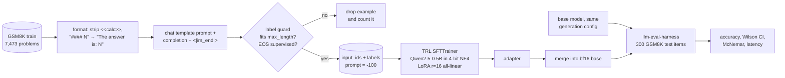

# qlora-finetune-demo

QLoRA fine-tuning of **Qwen2.5-0.5B** (base) on the **GSM8K** training set on a single **10 GB RTX 3080**, in about
16 minutes of training, with a before/after evaluation on 300 held-out GSM8K test problems using
[llm-eval-harness](https://github.com/erickmacielsoto/llm-eval-harness) — plus a guard and a test for a silent
data bug that is easy to ship: **label truncation**.

## Problem

Small open models are cheap to serve but often fail to follow a task format or to reason through multi-step
problems. QLoRA (4-bit NF4 base weights + low-rank adapters) makes adapting them feasible on consumer GPUs. The
interesting engineering is not the `trainer.train()` call; it is making sure the data the model is supervised on
is what you think it is, and measuring the result with the same harness and prompt before and after.

## Architecture



* `data.py` – prompt (identical to the harness prompt, enforced by a test) and solution formatting.
* `labels.py` – the label guard: `encode_prompt_completion`, `validate_labels`, `audit`, and `naive_encode`
  (the buggy recipe, kept for the test and the audit).
* `train.py` – loads the base in 4-bit with bitsandbytes, applies LoRA with peft, trains with TRL's `SFTTrainer`
  on pre-tokenised `input_ids`/`labels`, stops at a wall-clock budget (28 min) if needed, merges the adapter and
  saves both the merged model and a copy of the base with the **same** generation config, so the before/after
  comparison only differs in weights.

## The label-truncation bug

The common recipe is: tokenize `prompt + completion`, truncate to `max_length` from the right, then set the first
`len(prompt)` labels to `-100`. When the sequence is longer than `max_length`, truncation silently eats the end of
the completion:

* the **EOS token is never supervised**, so the model learns to keep generating after the answer; or
* if the prompt alone fills the window, **every label is `-100`**: the example contributes zero gradient (and a
  batch made only of such rows yields a NaN loss).

Nothing crashes; training loss looks fine. The audit below runs the naive recipe over the real GSM8K training set
with this tokenizer and chat template at several `max_length` values:

| `max_length` | Naive: rows with broken labels (EOS or answer tail cut) | Naive: rows with **zero** supervised tokens | Guard: rows dropped | Guard: broken rows kept |
|---:|---:|---:|---:|---:|
| 128 | 7,293 (97.6%) | 1,583 | 7,293 | 0 |
| 192 | 3,996 (53.5%) | 43 | 3,996 | 0 |
| 256 | 1,313 (17.6%) | 1 | 1,313 | 0 |
| 384 | 62 (0.8%) | 0 | 62 | 0 |
| 512 (used) | 0 | 0 | 0 | 0 |

At `max_length=256`, a value that looks generous for short math problems, the naive recipe would silently train
17.6% of the dataset to *not* end its answer.

Recent TRL versions drop *fully masked* rows on their own (the trainer logs "Dropping fully masked examples"), but
rows that lost only their EOS or the tail of the answer pass through. The guard in `labels.py` tokenizes prompt and
completion separately, **drops** any example that does not fit instead of truncating it, appends EOS if missing, and
validates that the last supervised token is EOS and that at least a minimum number of tokens are supervised. The
counts are logged in `results/train_summary.json` so a change of `max_length` that silently discards a large share
of the data is visible.

`tests/test_labels.py` reproduces both failure modes with a character-level tokenizer (no downloads) and asserts that
`validate_labels` rejects them and that the guarded encoder keeps the full completion with EOS.

## Results

Hardware: Windows 11, RTX 3080 10 GB, Python 3.12, torch 2.14.1+cu126, transformers 5.22.2, peft 0.21.2, trl 1.17.1, bitsandbytes 0.50.2.
**bitsandbytes 4-bit works natively on Windows with these versions**, so this is real QLoRA, not a LoRA fallback.

### Training

| | Run 1 (supervised EOS = `<|im_end|>`) | Run 2 (supervised EOS = `<|endoftext|>`) |
|---|---:|---:|
| Base model | Qwen/Qwen2.5-0.5B, 4-bit NF4, double quant, bf16 compute | same |
| LoRA | r=16, alpha=32, dropout 0.05, all linear layers | same |
| Trainable parameters | 8.80 M of 502.8 M (1.75%) | same |
| Data | 7,473 GSM8K train rows, 0 dropped at `max_length=512` | same |
| Steps (1 epoch, batch 8 × grad-accum 2) | 468 | 468 |
| Training time | 1,035.7 s (17.3 min) | 946.6 s (15.8 min) |
| Loss, first → last logged step | 0.963 → 0.628 | 0.743 → 0.544 |
| Peak GPU memory (allocated) | 5.32 GB | 5.32 GB |
| End-to-end script (train + merge + 2 evals) | 28 min 16 s | 20 min 14 s |

Run 2's base evaluation was reused from run 1: the `base-chat` weights and generation config are identical.

### Before / after (300 GSM8K test problems, same prompt, greedy, max 384 new tokens)

**Run 2 (final).** From `results/before_after.md`:

| Model | Accuracy | 95% CI (Wilson) | Hit 384-token limit | Mean output tokens | p50 s/item | Wall time | USD / 1k correct* |
|---|---:|---|---:|---:|---:|---:|---:|
| Qwen2.5-0.5B base | 28.0% | 23.2% – 33.3% | 178 / 300 | 297 | 0.942 | 289.7 s | 0.19 |
| + QLoRA (GSM8K, 1 epoch) | **33.3%** | 28.2% – 38.8% | **8 / 300** | **94** | **0.482** | 175.9 s | **0.10** |

| Comparison | Δ accuracy | 95% CI (paired bootstrap) | Discordant pairs (base only / tuned only) | McNemar exact p |
|---|---:|---|---:|---:|
| tuned − base | +5.3 pp | −1.0 to +11.7 pp | 41 / 57 | 0.13 |

\* assumed USD 0.20 per GPU-hour, applied to measured wall time.

What the numbers say: the fine-tuned model learned the task format and to stop — completions that ran into the
token limit fell from 178 to 8 and mean output length from 297 to 94 tokens — which halves latency and cost per
correct answer. The accuracy gain of +5.3 points is **not statistically significant** on 300 items (p = 0.13); a
larger eval set or more training would be needed to claim it.

**Run 1 (kept as a negative result).** Supervising `<|im_end|>` as the end-of-answer token produced a model that
almost never stopped: 240 / 300 completions hit the token limit, typically repeating
`The answer is: 7(Have a nice day!)`, and accuracy moved from 28.0% to 30.0% (p = 0.61). The probability the
fine-tuned model assigned to `<|im_end|>` right after a final answer was 0.0003, while the base model already put
0.475 on `<|endoftext|>` there. In this base checkpoint the chat-turn tokens' embedding rows have identical, below-average
norms (0.301 vs. a 0.464 mean), consistent with them being effectively untrained, and LoRA on linear layers does
not update the tied embedding / LM head, so the model cannot learn to emit that token. Run 2 supervises the token
the base model already knows. Files: `results/run1_im_end/`.

## Run it

```bash
pip install -e ".[train,eval,dev]"     # install a CUDA build of torch first
bash run_experiment.sh                   # train, merge, evaluate base and fine-tuned, write results/
```

Individual steps:

```bash
python -m qlora_demo.train --output-dir outputs --max-length 512 --time-budget-min 28
evalh run --model hf:outputs/base-chat --n 300 --out results/eval_base-chat.jsonl
evalh run --model hf:outputs/merged    --n 300 --out results/eval_merged.jsonl
evalh report results/eval_base-chat.jsonl results/eval_merged.jsonl --markdown results/before_after.md
```

`--no-quantize-4bit` trains plain LoRA on a bf16 base if bitsandbytes is unavailable.

## Tests

```bash
pytest -q
```

CI runs ruff, mypy (strict) and pytest on Python 3.10 and 3.12; the tests need no GPU or model downloads.

## Limitations

* One seed, one epoch, two runs that differ only in the supervised EOS token; no hyper-parameter search. The CI of the before/after difference is reported
  instead of claiming a precise improvement.
* GSM8K reference solutions are short; the model learns their terse style, which helps a small base model but
  would likely *hurt* an instruct model that already reasons at length.
* The adapter is trained against 4-bit weights and merged into the bf16 base, the usual QLoRA deployment path;
  this introduces a small mismatch that is not measured separately.
* Evaluation is exact match on the final number for 300 of the 1,319 test problems.

## License

MIT — see [LICENSE](LICENSE). Qwen2.5-0.5B is Apache-2.0; GSM8K is MIT.
